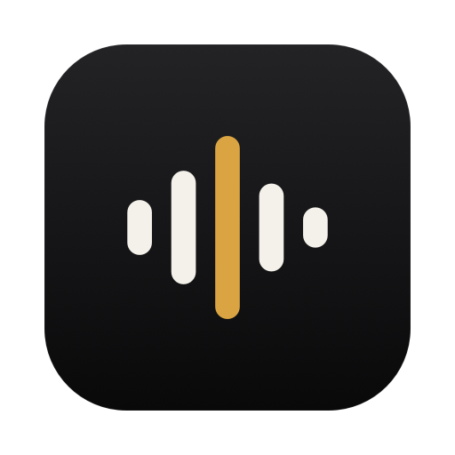

# Tynda

[](https://github.com/Markerloop-Team/tynda/releases) [](https://github.com/Markerloop-Team/tynda/actions/workflows/build.yml) [](LICENSE)

**Hold fn. Speak. It types.** A small, free, open-source Mac app that lets you talk instead of typing. Your voice is turned into text on your own Mac and typed wherever your cursor is.

*Tynda* (тыңда) is Kazakh for "listen". Made by [Markerloop](https://markerloop.com) · [tynda.markerloop.com](https://tynda.markerloop.com)

Free to use, open source, MIT. Pull requests are welcome — see [Contributing](#contributing).

> **Early alpha.** Tynda is new and has been used on one Mac. The download is not signed with an Apple Developer ID yet, so macOS asks for an extra click. Expect rough edges and tell us about them.

## How it works

- **Hold fn** and talk. Let go — the text appears where your cursor is, about a second later.
- **Double-tap fn** for hands-free. Talk as long as you like, press fn again to finish.
- **Esc** throws it away.
- **fn taken?** Pick another key in the setup window: Option, Control, the right Command or an F-key. Choose one you do not use for shortcuts.

A small black island with a live waveform shows at the top of the screen while Tynda listens. That is the whole app: no window to keep open, no account, and the defaults work from the first sentence.

Tynda starts with the languages of the keyboard layouts on your Mac, plus Kazakh (it comes from Kazakhstan, where people speak Kazakh more often than they type it). Add or remove languages in the setup window; it only ever considers the ones on your list, so a cough is not taken for a sentence in a language you do not speak.

**Your words.** Names, brands and terms can go into *My words* in the setup window. The speech model is shown the list before every phrase and spells those words your way more often — a hint, so not every time. Up to 100.

**Normalize.** If [Claude Code](https://claude.com/claude-code) is installed on your Mac, the island turns into a **Normalize** button after each dictation. Click it, and Claude rewrites what you said into what you meant — applies your own spoken corrections ("no, scrap that"), drops the filler, makes a list when you spoke in points — and puts it in place of the raw text. A switch in the setup window does this for every dictation without asking. Tynda holds no key and talks to no server itself: it runs the Claude Code you already have. Without Claude Code there is no button, and nothing changes.

**The icon tells you where things stand.** The wave means ready, dots filling in mean the model is loading, an exclamation mark means the setup needs you.

## Nothing is saved, nothing leaves your Mac

- Your voice is recognised on your Mac by [Whisper large-v3-turbo](https://huggingface.co/mlx-community/whisper-large-v3-turbo) running through Apple's [MLX](https://github.com/ml-explore/mlx). Once the model is downloaded, Tynda works with the network off. The one thing it asks the internet for by itself is the number of the newest release, once a day (the update itself is downloaded only when you click it); switch that off with `defaults write app.tynda.mac checkForUpdates -bool NO`.
- The audio lives for a second in a temporary file and is deleted as soon as it becomes text.
- The text is typed into your app and is not written anywhere else. There is no history.
- Your settings — the key, the languages and the *My words* list — stay in the app's preferences on your Mac.
- No account, no telemetry, no server.
- **The one exception is yours to make.** Normalize hands the text of a dictation — never the audio — to Claude Code on your Mac, which sends it to Anthropic like anything else you give Claude Code. It happens only when you click Normalize, or for every dictation if you switch that on in the setup window. It is off until you do, and absent without Claude Code.

## Requirements

| | |
|---|---|
| Mac | Apple silicon (M1 or newer). Intel Macs are not supported — the speech model does not run on them. |
| macOS | 14 Sonoma or newer |
| Memory | 8 GB minimum, 16 GB recommended. The model stays loaded (about 2 GB). |
| Disk | about 3 GB (model 1.6 GB + Python packages) |
| Tools | None for the download. To build from source: Xcode Command Line Tools, and Python 3.10–3.13 or [uv](https://docs.astral.sh/uv/) |
| Keyboard | The fn / 🌐 key set to "Do Nothing" in System Settings → Keyboard — or another key of your choice |

## Install

### Download

1. Download **[Tynda-0.5.0.dmg](https://github.com/Markerloop-Team/tynda/releases/download/v0.5.0/Tynda-0.5.0.dmg)** (20 MB), open it and drag Tynda into Applications.
2. Open Tynda from Applications. It is not signed with an Apple Developer ID, so macOS refuses the first time: open System Settings → Privacy & Security and click **Open Anyway**.
3. Tynda installs its speech engine and downloads the model by itself — about 3 GB, a few minutes. The setup window shows how far it is.

No git, Homebrew or Terminal needed. Everything Tynda installs goes into `~/Library/Application Support/Tynda`, and the model into `~/.cache/huggingface`.

### Or build from source

```bash
git clone https://github.com/Markerloop-Team/tynda.git
cd tynda
./install.sh
```

The script checks your Mac, downloads the speech model, builds the app and puts it into `~/Applications`. It takes a few minutes the first time, mostly the download.

### The setup window

Either way, a setup window opens and walks you through the rest, with a live check mark for each step:

1. **Microphone** — to hear you.
2. **Accessibility** — to notice the fn key and to type the text for you.
3. **Dictation key** — fn has to be free ("Do Nothing" in Keyboard settings), or pick another key right there.
4. **Languages** — your keyboard layouts' languages and Kazakh to begin with; change the list any time.
5. **My words** — optional: names and terms to spell your way.
6. **Speech model** — loads in a few seconds. After a download install, this is where you watch it being fetched.

Then it gives you a text field to try your first dictation in. You can open this window again any time: Tynda icon in the menu bar → *Setup…*, or just open Tynda again from Applications.

To update: Tynda shows a line in its menu when a new version is out — click it, and Tynda downloads the new version, replaces itself and starts again — or `git pull && ./install.sh`. What changed in each version is in [CHANGELOG.md](CHANGELOG.md) and on the [releases page](https://github.com/Markerloop-Team/tynda/releases). Because the app is not signed with an Apple Developer ID, macOS treats each new build as a new app and asks for the permissions again.

## Uninstall

Installed from the download: quit Tynda, drag it from Applications to the Trash, and delete `~/Library/Application Support/Tynda`.

With the source at hand:

```bash
./uninstall.sh          # the app, its settings, permissions and Python environment
./uninstall.sh --all    # also the downloaded speech model (1.6 GB)
```

## How it is built

- `Sources/main.m` — the whole app in one Objective-C file: the menu bar icon, the island, microphone capture (AVAudioEngine), the fn listener (CGEventTap), pasting, and the setup window.
- `dictate_server.py` — keeps the speech model loaded so a phrase takes about a second instead of five.
- `build.sh` / `install.sh` / `uninstall.sh` — no Xcode project; `clang` is enough.
- `setup_engine.sh` — travels inside the app; installs the speech engine when the app was downloaded rather than built.
- `tools/make_dmg.sh` — builds the downloadable disk image, with [uv](https://docs.astral.sh/uv/) inside so the app can set itself up.
- `tools/make_icon.m` — draws the icon; `tools/make_icon.sh` regenerates the image files.

The only file Tynda writes is a diagnostics log, `~/Library/Logs/Tynda.log`. It records events and timings ("recorded 2.5s", "23 characters in 1.4s") and never what you said.

## Known limits

- Not signed or notarised: macOS wants a click on Open Anyway the first time, and permissions reset on every update.
- The text is pasted through the clipboard (your clipboard is restored half a second later).
- If the menu bar is full, macOS may hide the Tynda icon. Dictation still works; open Tynda again from Applications to get to the setup window.
- Tested on macOS 26 only.

## Contributing

Tynda is small on purpose, and that is the main thing to protect. Ideas that fit:

- a signed, notarised download, so nobody has to build from source;
- better punctuation and style for more ways of speaking (`STYLE` in `dictate_server.py`);
- making it work, or fail clearly, on Macs it has not met yet.

Three rules every change has to keep: nothing is saved, nothing leaves the Mac unless the user asks for it, and there is nothing to configure before the first sentence. [CONTRIBUTING.md](CONTRIBUTING.md) has the practical part — how to build, test and send a pull request.

Found a bug? [Open an issue](https://github.com/Markerloop-Team/tynda/issues) and attach `~/Library/Logs/Tynda.log` (it has timings, not your words).

## License

[MIT](LICENSE)
